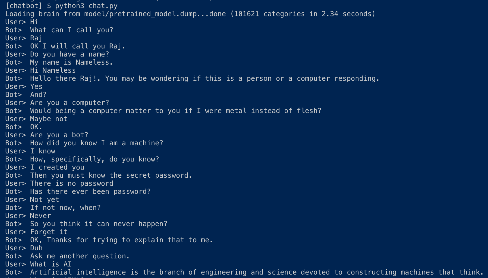
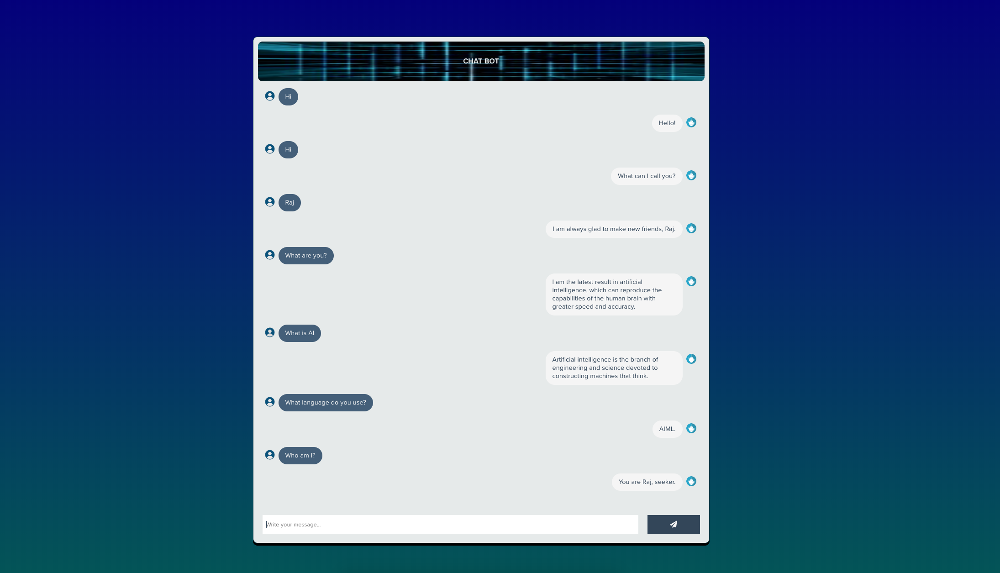

# Chatbot

> **2026 update:** This is an early project, kept as it was built. My current work on natural-language interfaces is [ai-agent-chatbot](https://github.com/likarajo/ai-agent-chatbot), a safe natural-language-to-SQL agent over public energy data.

This repository holds two programs: an AIML chatbot, and a voice assistant. They are started separately. The CLI does not listen to the microphone, and the voice program does not take typed chat.

## How to access each

### Typed CLI, spoken reply

`chat.py` reads what you type and speaks the reply. The microphone is not used.

1. From this directory, install both dependency lists. `chat.py` imports the AIML packages and the speech packages.

```bash
pip3 install -r requirements.txt
pip3 install -r requirements2.txt
```

2. Start the CLI.

```bash
python3 chat.py
```

3. Wait until it prints `Bot> I am ready!` and plays that sentence.
4. Type at the `User>` prompt. The reply is printed and played from `temp/audio.mp3`.
5. Type `quit` or `exit` to stop.

### Typed web page

`webchat.py` is text only. Nothing is spoken, and the microphone is not used. It imports the same speech libraries, so the two install commands above are required.

```bash
python3 webchat.py
```

Open http://localhost:5000 and type in the page.

### Microphone

`myassistant.py` listens. There is no `User>` prompt.

On macOS, install PortAudio and certificates before the Python packages:

```bash
brew install portaudio
pip3 install -r requirements2.txt
python3 util/install_certifi.py
```

Then start it:

```bash
python3 myassistant.py
```

It prints `listening...` and sends what you say to Google's speech service. Stop it from the terminal with Ctrl+C.

## AIML chatbot

### Environment
Python 3.7.x, pip3

### Requirements
* Flask
* **AIML** [Learn More](http://www.aiml.foundation/)<br>
   ***Arificial Intelligence Markup Language*** is an XML dialect for creating natural language software agents.

```bash
pip3 install -r requirements.txt
pip3 install -r requirements2.txt
```

^ *sudo* if required.

`chat.py` and `webchat.py` import the speech libraries, so both requirement files are needed before either program will start.

### Run

Typed CLI. You type at `User>`. The reply is printed and spoken. The microphone is not used.

```bash
python3 chat.py
```

Wait for `Bot> I am ready!`. Type `quit` or `exit` to stop.

<div align="center">
    
</div>

Typed web page. You type in the browser. The reply stays on the page. Nothing is spoken, and the microphone is not used.

```bash
python3 webchat.py
```

Open **http://localhost:5000**.

<div align="center">
    
</div>

### Appendix
* **chat.py**: code for loading and running the bot in CLI
* **webchat.py**: code for loading and running the bot on web
* **data/**: folder containing the AIML files
* model/**learning_files.aiml**: code for listing the files to train the bot
* model/**pretrained_model.dump**: a saved trained model that the bot can use
* templates/**home.html**: the html file for the web UI
* **requirements.txt**: file listing the Python dependencies

### References
[AIML tutorial](https://www.tutorialspoint.com/aiml/index.htm)
[Flask tutorial](https://www.tutorialspoint.com/flask/flask_application.htm)
[autocorrect](https://github.com/fsondej/autocorrect)
[Bootsnipp](https://bootsnipp.com/)

### PS
* More AIML files can be added/updated into the *data/* folder to improve the bot.
* A variety of HTML templates can be used from [Bootsnipp](https://bootsnipp.com/to) to improve the look of the web chat UI.

## Voice assistant

### Dependencies

```sh
# Install package for device audio
brew install portaudio

# Create a virtual environment and activate it (optional)
pip3 install virtualenv
virtualenv venv
. venv/bin/activate

#Install the required libraries
pip3 install -r requirements2.txt

#Install certificates
python3 util/install_certifi.py
```

On macOS run **install_certificates.command**

* **gTTS (Google Text-to-Speech)**: Python library and CLI tool to interface with ***Google Translate***'s *text-to-speech* API. This module helps to convert String text to Spoken text and can be saved as .mp3.

* **SpeechRecognition**: To retrieve speech input and process audio files. The Google Web Speech API supports a default API key that is hard-coded into the SpeechRecognition library

* **PyAudio**: To access the microphone.

* **pygame**: A cross-platform set of Python modules containing computer graphics and sound libraries.

* **webbrowser**: (built-in package) To display Web-based documents.

* **re**: (built-in package) Regular expressions to detect availability of user commands by matching them.

* **smtplib**: (built-in package) To send emails by communicating with mail servers via Simple Mail Transfer Protocol (SMTP).

* **requests**: To access HTTP API.

* **bs4**: Beautiful Soup 4, to pull data out of HTML and XML files.

* **urllib**: (built-in package) To access any URL

### Access

Microphone only. There is no `User>` prompt.

```bash
python3 myassistant.py
```

It prints `listening...` and sends what you say to Google's speech service. Stop it from the terminal with Ctrl+C.

### [Functionalities](files/functionalities.md)

* Talk
* Get User Input
* Assistant (perform tasks)
* Search Google
* Send email
* Search wikipedia
